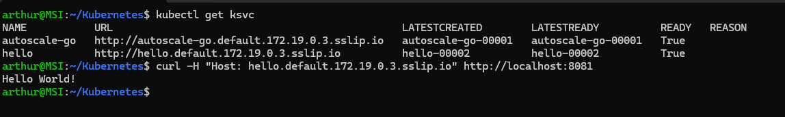

# knative

Chapter 6, exercise 5.6 ("Trying serverless"): installs [Knative Serving](https://knative.dev/) on its **own, separate k3d cluster** — unlike every other exercise so far, which shares one `k3s-default` cluster. Knative needs Kubernetes 1.34+ and no pre-existing Ingress controller (Traefik conflicts with it), neither of which the main cluster satisfies, so the course has you create a dedicated cluster instead.

Since both clusters would otherwise fight over the same host ports (`8081`/`8082`) and this session had already hit real WSL memory pressure more than once, `k3s-default` is **stopped** (not deleted — `k3d cluster stop k3s-default`) while this one is in use:

```bash
k3d cluster stop k3s-default   # frees the ports and the memory; resume later with `k3d cluster start k3s-default`

k3d cluster create knative --port 8082:30080@agent:0 -p 8081:80@loadbalancer --agents 2 --k3s-arg "--disable=traefik@server:0" --image rancher/k3s:v1.34.1-k3s1
```

Everything below runs in the `default` namespace (same as the official Knative examples) — this exercise doesn't touch `exercises`/`project`, since it's a throwaway cluster just for trying the feature out.

## Install

Following the [official YAML install guide](https://knative.dev/docs/install/yaml-install/serving/install-serving-with-yaml/), pinned to the latest release at the time (`knative-v1.23.0`, which also matches what `k3d cluster create --image rancher/k3s:v1.34.1-k3s1` requires):

```bash
kubectl apply -f https://github.com/knative/serving/releases/download/knative-v1.23.0/serving-crds.yaml
kubectl apply -f https://github.com/knative/serving/releases/download/knative-v1.23.0/serving-core.yaml

# Kourier as the networking layer
kubectl apply -f https://github.com/knative-extensions/net-kourier/releases/download/knative-v1.23.0/kourier.yaml
kubectl patch configmap/config-network --namespace knative-serving --type merge \
  --patch '{"data":{"ingress-class":"kourier.ingress.networking.knative.dev"}}'

# Magic DNS (sslip.io)
kubectl apply -f https://github.com/knative/serving/releases/download/knative-v1.23.0/serving-default-domain.yaml
```

**Unlike the exercise's own example output**, every pod in `knative-serving`/`kourier-system` came up `Running` on the first try here — no `CrashLoopBackOff` to debug. The `serving-default-domain` Job picked up the Kourier LoadBalancer's address automatically and set the cluster's default domain to `172.19.0.3.sslip.io` (confirmed via its logs: `Updated default domain to: 172.19.0.3.sslip.io`).

## Example 1: deploying a Knative Service, and scale-to-zero

`examples/hello.yaml`'s base revision (before the traffic-split section below was added) is the [official "hello" example](https://knative.dev/docs/getting-started/first-service/) — `ghcr.io/knative/helloworld-go`, which echoes `Hello ${TARGET}!`:

```bash
kubectl apply -f examples/hello.yaml
kubectl get ksvc hello
# URL: http://hello.default.172.19.0.3.sslip.io

curl -H "Host: hello.default.172.19.0.3.sslip.io" http://localhost:8081
# Hello World!
```



(Note: the `Host` header's value is a bare hostname, not a URL — `curl -H "Host: http://hello..." ...` sends that literal string as the header and gets a `400 Bad Request` back; drop the `http://` prefix from the header value itself.)

**Tested the signature serverless behavior** — scale-to-zero and back:
- Left it idle; after ~100s, `kubectl get pods -l serving.knative.dev/service=hello` returned **no resources found** — Knative's activator had scaled the Deployment to 0 replicas.
- A single `curl` request immediately after (same command as above) still returned `Hello World!`, and a new pod appeared (`kubectl get pods` showed one `Running`, `age: 1s`) within about 1.3 seconds — the activator buffered the request, triggered a cold start, and forwarded it once the pod was ready.

## Example 2: autoscaling

`examples/autoscale-go.yaml` is the [official autoscale-go example](https://knative.dev/docs/serving/autoscaling/autoscale-go/) (`ghcr.io/knative/autoscale-go`, `autoscaling.knative.dev/target: "10"` — 10 in-flight requests per pod instead of the default 100):

```bash
kubectl apply -f examples/autoscale-go.yaml
kubectl get ksvc autoscale-go
```

The guide's own load-testing tool, `hey`, means downloading and running a third-party pre-built binary — skipped in favor of the same effect with a tool already trusted in this environment, 50 parallel `curl` loops hitting the endpoint for 30 seconds:

```bash
URL="http://localhost:8081/?sleep=100&prime=10000&bloat=5"
HOST="autoscale-go.default.172.19.0.3.sslip.io"
END=$((SECONDS + 30))
for i in $(seq 1 50); do
  ( while [ $SECONDS -lt $END ]; do curl -s -o /dev/null -H "Host: $HOST" "$URL"; done ) &
done
wait
```

**Tested**: `kubectl get pods -l serving.knative.dev/service=autoscale-go` during/right after the load showed **7 running pods** (vs. 1 at rest) — curl loops don't hold concurrency as precisely fixed as `hey -c 50` does, so it's not exactly the guide's own worked example of 5 (50 concurrent ÷ target 10), but it's the same order of magnitude and clearly demonstrates the autoscaler reacting to load.

## Example 3: traffic splitting

Extended `hello` with a second revision (`hello-00002`, `TARGET=Knative v2`, explicitly named via `template.metadata.name` so it can be referenced deterministically) and a 50/50 `spec.traffic` split between it and the original (`hello-00001`), each given a `tag` for direct access — see the full `examples/hello.yaml`:

```yaml
traffic:
  - tag: v1
    revisionName: hello-00001
    percent: 50
  - tag: v2
    revisionName: hello-00002
    percent: 50
```

```bash
kubectl apply -f examples/hello.yaml
kubectl get route hello -o jsonpath='{range .status.traffic[*]}{.tag}{"\t"}{.percent}{"\t"}{.url}{"\n"}{end}'
# v1   50   http://v1-hello.default.172.19.0.3.sslip.io
# v2   50   http://v2-hello.default.172.19.0.3.sslip.io
```

**Tested** both the tagged, pinned URLs and the split on the main URL (40 requests against the plain `hello.default...` host, same shape as the traffic-split tests in `../service-mesh/README.md` and `../greeter/README.md`):

```bash
curl -s -H "Host: v1-hello.default.172.19.0.3.sslip.io" http://localhost:8081   # Hello World!
curl -s -H "Host: v2-hello.default.172.19.0.3.sslip.io" http://localhost:8081   # Hello Knative v2!

for i in $(seq 1 40); do curl -s -H "Host: hello.default.172.19.0.3.sslip.io" http://localhost:8081; echo; done | sort | uniq -c
#      23  Hello Knative v2!   (≈57%, target 50%)
#      17  Hello World!        (≈43%, target 50%)
```

Close enough to the configured 50/50 split given normal sampling variance over 40 requests (same margin seen in the mesh-based traffic splits elsewhere in this repo).

## Cleanup / switching back

```bash
k3d cluster stop knative
k3d cluster start k3s-default   # back to the main cluster for every other exercise
```
