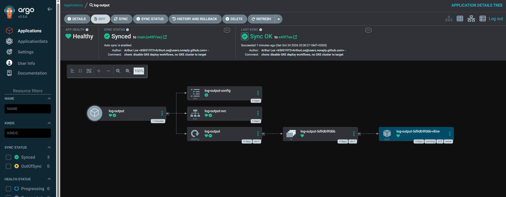
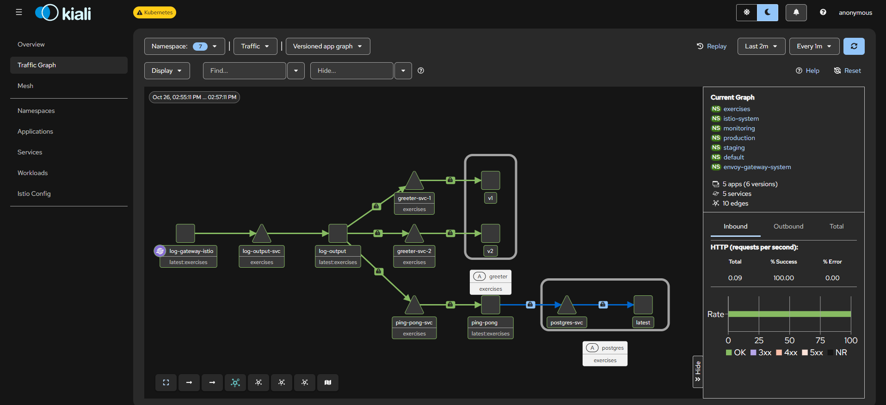

# Log output

Two containers sharing one Pod, communicating via a shared `emptyDir` volume:

- **`writer/`** — generates a random string on startup, (re)writes a line (timestamp + the string) to a shared file every 5 seconds, overwriting the previous one. No HTTP server, no stdout logging anymore — the file *is* the log.
- **`reader/`** — Express server; `GET /status` returns the file content and env variable from a `ConfigMap` (exercise 2.5), then that status line plus the current ping-pong count, fetched live over HTTP from `../ping-pong` (`GET http://ping-pong-svc:3000/pings`, as of exercise 2.1 — no more shared volume between the two apps), e.g.:
  ```
  file content: this text is from file
  env variable: MESSAGE=hello world
  2026-10-04T16:29:17.416Z: 1d0f0cba-d291-4963-a8e9-09d3d724948a.
  Ping / Pongs: 3
  ```

The reader's port is configurable via the `PORT` environment variable (defaults to `3000`); the ping-pong URL via `PINGPONG_URL` (defaults to `http://ping-pong-svc:3000/pings`); as of exercise 5.3, the greeter URL via `GREETER_URL` (defaults to `http://greeter-svc:3000/`, see "Exercise 5.3" below). The `writer`/`reader` pair still agree on the status file path via `FILE_PATH` (defaults to `/usr/src/app/shared/status.txt`), mounted from an `emptyDir` volume local to this Pod — that one stays, it's internal to `log_output` itself.

As of exercise 3.2, the reader also responds `200` on `GET /` — GKE's Ingress health-checks a backend Service at `/` regardless of which path it's actually routed under (`/status` here), so without this the Ingress would never mark the backend healthy.

As of exercise 4.1, the reader also has a `GET /healthz`, separate from the stub above: it actually calls `../ping-pong` (the same `PINGPONG_URL` used by `/status`) and returns `200` only if that succeeds. A `readinessProbe` in `manifests/deployment.yaml`/`manifests/gke/deployment.yaml` uses this to report the reader as not-ready whenever it can't currently reach Ping-pong — see "Exercise 4.1" below.

As of exercise 2.5, a `ConfigMap` (`manifests/configmap.yaml`, `log-output-config`) provides `information.txt` (mounted as a volume at `/usr/src/app/config/information.txt`, path configurable via `INFO_FILE_PATH`) and the `MESSAGE` env variable, both read by the reader and printed at the top of `/status`.

As of exercise 2.3, this app runs in the `exercises` namespace (see `../manifests/namespace-exercises.yaml`), together with `../ping-pong` — every exercise outside `the_project` lives there from now on.

## Local development

Run both separately, pointing at the same local file:

```bash
cd writer && FILE_PATH=/tmp/status.txt npm install && npm start
cd reader && FILE_PATH=/tmp/status.txt npm install && npm start
```

## Build and deploy

```bash
# build both images (bump tags when the code changes)
docker build -t log-output-writer:1.1.0 writer/
docker build -t log-output-reader:1.6.0 reader/

# get cluster name if you don't know it
k3d cluster list

# load them into your local cluster
k3d image import log-output-writer:1.1.0 log-output-reader:1.6.0 -c <cluster-name>

# the exercises namespace, the ConfigMap and the shared Gateway must exist first (repo root, spans multiple apps)
kubectl apply -f ../manifests/namespace-exercises.yaml
kubectl apply -f manifests/configmap.yaml
kubectl apply -f ../manifests/gateway.yaml

# update the image tags in manifests/deployment.yaml to match, then apply
kubectl apply -f manifests/deployment.yaml
kubectl apply -f manifests/service.yaml
kubectl rollout status deployment/log-output -n exercises

# confirm it's running (2/2 containers ready)
kubectl get pods -n exercises

# logs per container, since there's more than one now
kubectl logs -f <pod-name> -n exercises -c writer
kubectl logs -f <pod-name> -n exercises -c reader
```

Note: `writer` won't print anything to `kubectl logs` by design — it writes to the shared file instead. That's expected.

## Access it locally

As of chapter 5, exposed via the shared `Gateway`/`HTTPRoute` (`../manifests/gateway.yaml`, `gatewayClassName: eg`, Envoy Gateway — Traefik is disabled on this cluster), shared with the `../ping-pong` application:
- `/status` → this app (reader)
- `/pingpong` → ping-pong (rewritten to `/`)

`the_project`'s own `HTTPRoute` (`../the_project/manifests/gateway.yaml`) separately owns `/` and `/todos`, attached to the same Gateway — no overlap between the two. Reachable on whichever host port your k3d cluster maps to the load balancer's port 80 (e.g. `http://localhost:8081/status`) — check your cluster's port mapping.

## Exercise 3.2: deploying to GKE with Ingress

`manifests/gke/deployment.yaml` and `manifests/gke/service.yaml` are GKE-specific variants, analogous to `../ping-pong/manifests/gke/` (see that app's README for the full GKE build/deploy/cleanup flow — cluster create, Artifact Registry push, cluster delete). Differences from the local manifests:
- `gke/deployment.yaml` — images from Google Artifact Registry instead of a locally-imported image.
- `gke/service.yaml` — originally `type: NodePort` for this exercise (GKE's Ingress controller requires a NodePort backend Service, it doesn't expose the NodePort externally itself); changed to `ClusterIP` in exercise 3.3 below. The `3.2` git tag still has the `NodePort` version.

`manifests/configmap.yaml` is reused as-is (nothing cluster-specific in it). Exercise 3.2 reused the root `../manifests/ingress.yaml` unchanged on GKE too (GKE provisions its own `gce` `IngressClass` by default) — as of exercise 3.3 that Ingress has been replaced by a Gateway, see below.

## Exercise 3.3: Gateway API instead of Ingress

`gke/service.yaml` is back to `type: ClusterIP` — the Gateway API's `HTTPRoute` targets a regular ClusterIP Service directly, no NodePort needed (unlike Ingress). The actual routing now lives in `../manifests/gke/gateway.yaml` (shared with `../ping-pong`, since it's one `Gateway` + one `HTTPRoute` with two rules — same shape as the old shared Ingress) — see `../ping-pong/README.md`'s "Exercise 3.3" section for the full explanation and combined deploy flow.

```bash
kubectl apply -f manifests/gke/service.yaml   # ClusterIP now
kubectl apply -f ../manifests/gke/gateway.yaml

# wait for the Gateway to get an address (can take several minutes; 404/502 is normal while it provisions)
kubectl get gateway my-gateway -n exercises --watch
curl http://<gateway-address>/status
curl http://<gateway-address>/pingpong

# the old Ingress is no longer needed once the Gateway works — remove it to avoid paying for two load balancers
kubectl delete -f ../manifests/ingress.yaml
```

## Exercise 4.1: readiness probe

The reader is ready once it can actually reach `../ping-pong` — `GET /healthz` calls `PINGPONG_URL` and returns `500` if that fails, `200` otherwise. `manifests/deployment.yaml`/`manifests/gke/deployment.yaml` wire this up as a `readinessProbe` (`initialDelaySeconds: 5`, `periodSeconds: 5`) on the `reader` container only — `writer` has no HTTP server and gets no probe.

This cascades naturally from Ping-pong's own readiness (exercise 4.1 in `../ping-pong/README.md`): a Service only sends traffic to Ready pods, so while `ping-pong`'s Pod is `0/1` (Postgres unavailable), `ping-pong-svc` has zero endpoints, `PINGPONG_URL` fails to connect, and this reader correctly drops to not-ready too — no explicit dependency wiring needed, just two independent readiness probes composing through the Service layer. Tested together with `../ping-pong`'s test (see that README): scaling Postgres to 0 replicas drops both to not-ready, scaling it back to 1 brings both back within a few seconds.

## Exercise 4.7: GitOps with ArgoCD

`argocd-application.yaml` (kept outside `manifests/` on purpose — see its own comment) registers this app with [ArgoCD](https://argo-cd.readthedocs.io/) (installed locally per the chapter 5 "GitOps" reading — see the root README), applied once:

```bash
kubectl apply -f argocd-application.yaml
```

From then on ArgoCD polls this repo's `main` branch (default ~180s) and applies everything under `manifests/*.yaml` (non-recursive — `manifests/gke/` is correctly ignored) straight into the `exercises` namespace:
- `prune: true` — removes anything deleted from git.
- `selfHeal: true` — reverts manual `kubectl` drift back to match git.

No `kubectl apply` needed for day-to-day changes to this app anymore: **commit and push, ArgoCD does the rest.**



**Tested**: added the `app.kubernetes.io/managed-by: argocd-gitops` label to the Pod template in `manifests/deployment.yaml` and pushed straight to `main` — no manual `kubectl apply` at all. Confirmed via `kubectl get application log-output -n argocd` that ArgoCD picked up the new commit on its own and reported `Synced`/`Healthy` at the new revision, and via `kubectl get pods -n exercises -o jsonpath='{.items[0].metadata.labels}'` that the running Pod was rolled and now carries the new label — proof the whole path (git push → ArgoCD detects → applies → Deployment rolls) works without a human touching the cluster.

Note: `MESSAGE` (the `ConfigMap`-sourced env var on `reader`) would *not* have shown this automatically — Kubernetes doesn't restart a Pod just because a `ConfigMap` it reads via `env.valueFrom` changed, only a Pod *template* change (like the label above) triggers a rollout. A future improvement would be a checksum annotation on the template derived from the `ConfigMap`'s content, forcing a rollout whenever it changes too — not needed for this exercise.

ArgoCD itself runs on the same local k3d cluster (no GKE/cloud involved, consistent with the rest of chapter 5) — reachable at `https://localhost:8443` via `kubectl port-forward -n argocd svc/argocd-server 8443:443` (its `Service` is `type: LoadBalancer` per the course material, but k3d can't give it a real external IP here since the shared Envoy Gateway already occupies the one host port 80/443 mapping this cluster has — port-forward is the local equivalent).

## Exercise 5.3: Log app, the Service Mesh Edition

The `exercises` namespace (this app plus `../ping-pong`) was joined to [Istio](https://istio.io/)'s ambient mesh, installed on this cluster in exercise 5.2:

```bash
kubectl label namespace exercises istio.io/dataplane-mode=ambient
istioctl waypoint apply --enroll-namespace --wait --namespace exercises   # L7 routing, needed for ../greeter's traffic split
```

No manifest changes were needed for this step — the reader's existing `readinessProbe` (`GET /healthz`, which itself depends on reaching `../ping-pong`) and `../ping-pong`'s own `readinessProbe` (Postgres connectivity) both passed immediately after labeling, confirming ztunnel's transparent mTLS interception doesn't break anything already working, exactly as seen with Bookinfo in exercise 5.2.

A new `../greeter` microservice (its own top-level folder, same pattern as `../ping-pong` — see its README) responds to `GET /` with a greeting. The reader now also fetches it (`GREETER_URL`, defaults to `http://greeter-svc:3000/`, same env-var-with-a-cluster-DNS-default pattern as `PINGPONG_URL`) and appends it to `/status`:

```
file content: this text is from file
env variable: MESSAGE=hello world
2026-10-26T13:30:06.254Z: facc901f-c77a-4df2-b1c8-6efd7f3a7440.
Ping / Pongs: 10
greetings: Hello from version 1
```

`../greeter` runs two versions behind one `greeter-svc`, split 75/25 via a Gateway-API `HTTPRoute` — see its README for the full setup and the standalone traffic-split test. **Tested end-to-end** through this app's own `/status`, confirming the split is visible all the way through `log_output` → `greeter-svc` → `greeter-v1`/`v2`, not just when calling `greeter-svc` directly:

```bash
for i in $(seq 1 20); do curl -s http://localhost:8081/status | grep greetings; done | sort | uniq -c
#      15  greetings: Hello from version 1   (≈75%, target 75%)
#       5  greetings: Hello from version 2   (≈25%, target 25%)
```

### A dedicated Istio Gateway, for mesh-visible ingress

The course's own example for this exercise shows traffic entering the mesh through a node named `log-gateway-istio` in Kiali — not through the existing Envoy Gateway (`../manifests/gateway.yaml`, which is a separate, non-mesh ingress and stays as the normal way to reach `/status` at `http://localhost:8081/status`, unaffected by any of this). To match that, `manifests/istio-gateway.yaml` adds a second, Istio-managed `Gateway`+`HTTPRoute` for this app specifically — same pattern as `../service-mesh/gateway-api/bookinfo-gateway.yaml` from exercise 5.2:

```bash
kubectl apply -f manifests/istio-gateway.yaml
kubectl annotate gateway log-gateway networking.istio.io/service-type=ClusterIP --namespace=exercises
```

Creating a `Gateway` named `log-gateway` with `gatewayClassName: istio` makes Istio provision a Service named `log-gateway-istio` for it — exactly the node name in the course's screenshot. Annotated `ClusterIP` (k3d's `ServiceLB` already has the one host-port-80 slot taken by the Envoy Gateway, same reasoning as `bookinfo-gateway` in 5.2), so it's reached locally via port-forward:

```bash
kubectl port-forward svc/log-gateway-istio -n exercises 8090:80
curl http://localhost:8090/status
```

**Tested**: `curl http://localhost:8090/status` returned the same output as above, confirming the request actually flowed through the new gateway end-to-end. Also confirmed visually in Kiali (namespace `exercises`, `istioctl dashboard kiali`) after sending traffic through this gateway — the graph shows `log-gateway-istio` → `log-output` calling both `ping-pong` (→ `postgres` via `postgres-svc`) and `greeter-svc-1`/`greeter-svc-2` (split by the configured weights), matching the course's example shape exactly:



(Initial attempts at this screenshot kept showing an unrelated `envoy` node instead — traced to a leftover browser tab still polling the old Envoy Gateway route at `localhost:8081/status` in the same time window, not a problem with the Istio setup. Both ingress paths are real and coexist; this screenshot's window just happens to only have traffic through `log-gateway-istio`.)

### Also in this exercise: `ping-pong` back to a plain Deployment

Unrelated to the mesh itself, but needed before `../ping-pong` could be scaled back up: its `Rollout` (exercise 4.4, Argo Rollouts canary) had been orphaned by chapter 6's earlier cleanup (the Argo Rollouts controller was uninstalled, since nothing remaining needs it) and was replaced by a plain `Deployment` — see `../ping-pong/README.md`'s "Chapter 6: back to a plain Deployment" section.
