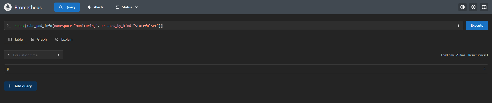

# Exercise 4.3: Prometheus

The full chapter 3 monitoring stack is installed locally via Helm, in its own `monitoring` namespace (gitignored `monitoring/*-values.yaml` at the repo root): `prom` (`prometheus-community/prometheus`), `loki` (`grafana/loki`), `k8smon` (`grafana/k8s-monitoring`, i.e. Alloy), and `grafana` (`grafana/grafana`) — installed in that dependency order, same as chapter 3.

```bash
kubectl create namespace monitoring
helm install prom prometheus-community/prometheus -n monitoring -f monitoring/prom-values.yaml
helm install loki grafana/loki -n monitoring -f monitoring/loki-values.yaml
helm install k8smon grafana/k8s-monitoring -n monitoring -f monitoring/k8smon-values.yaml
helm install grafana grafana/grafana -n monitoring -f monitoring/grafana-values.yaml

# port-forward through the Service, not a specific pod
kubectl port-forward svc/prom-prometheus-server -n monitoring 9090:80
```

PromQL query from the exercise — the number of pods owned by a `StatefulSet`, filtered via `kube_pod_info`'s `created_by_kind`/`created_by_name` labels (from `kube-state-metrics`):

```promql
count(kube_pod_info{namespace="monitoring", created_by_kind="StatefulSet"})
```

Result: `3` — matching the exercise's own example exactly. `prometheus-community/prometheus` and `grafana/grafana` run everything as plain `Deployment`s/`DaemonSet`s (no `StatefulSet`s), but **Loki** does: with `deploymentMode: SingleBinary`, its chart creates `loki-0` plus two memcached-backed caches, `loki-chunks-cache-0` and `loki-results-cache-0` — all three `StatefulSet`-owned, which is exactly what this query counts.


