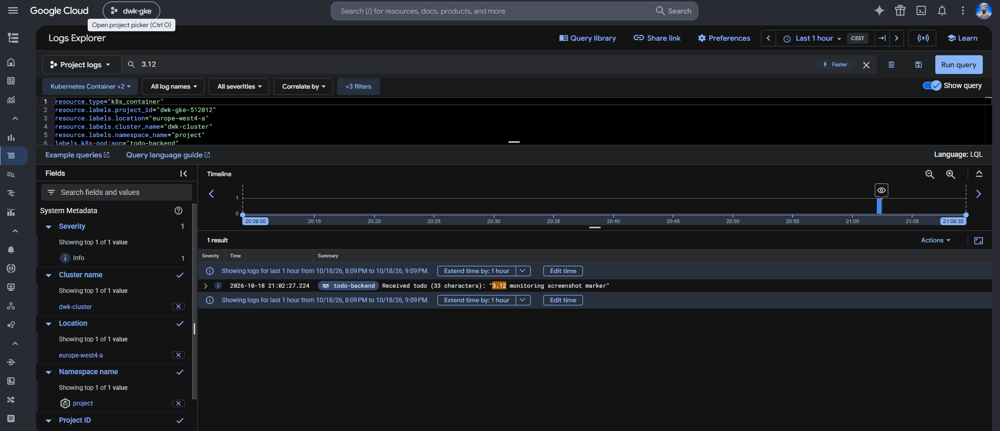
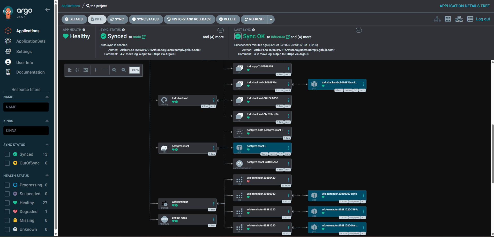
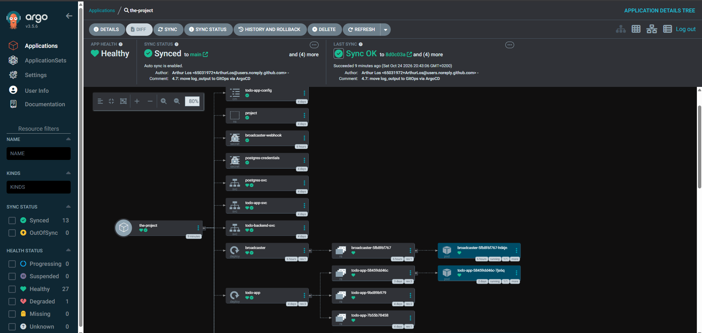
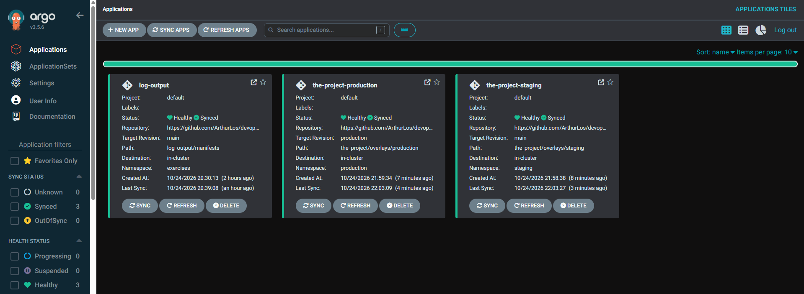
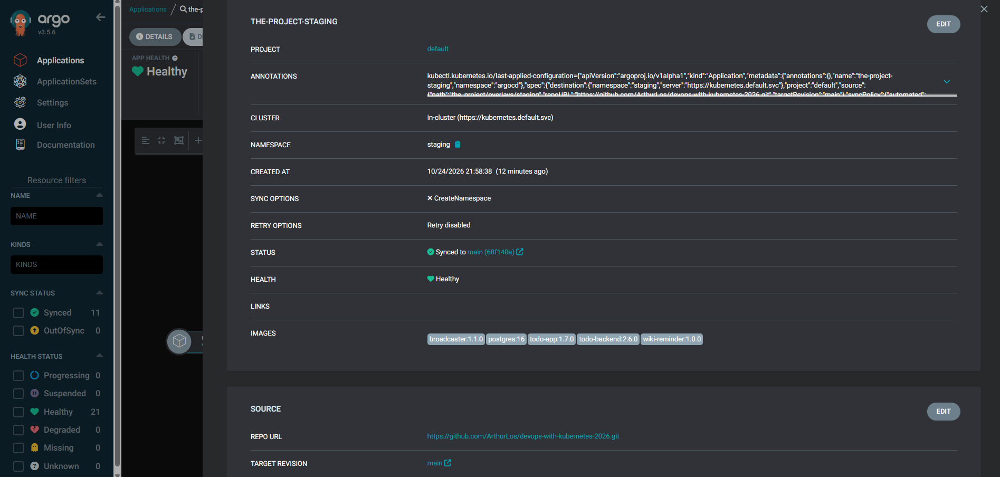
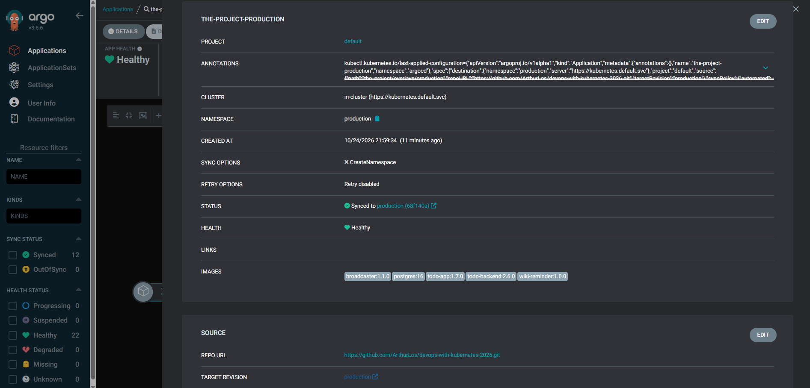

# the_project

The course's main project: a todo app (`todo-app/`, the frontend + cached-image service), its backend (`todo-backend/`, Postgres-backed todo storage), and a CronJob that periodically adds a "read this" reminder todo (`wiki-reminder/`). See each subfolder's own README for details on that specific service.

As of exercise 3.5, the whole project is deployed to GKE as **one unit via [Kustomize](https://kustomize.io/)** (`kustomization.yaml` in this folder) instead of applying each app's manifests one by one. This also solves the ordering problem the course material calls out: `kubectl apply -f manifests/` applies files alphabetically, which breaks if (for example) a ConfigMap is created before its namespace exists — Kustomize instead applies resources in the order you list them in `resources:`.

## What `kustomization.yaml` does

- **`resources`** lists every manifest that makes up the project, in dependency order: the `project` namespace first, then Postgres (Secret, StatefulSet), `todo-backend`, then `todo-app`'s ConfigMap/PVC/Deployment/Service, the shared Ingress, and finally the `wiki-reminder` CronJob.
- **`images`** rewrites each Deployment/CronJob's image at build time to its Artifact Registry location (`europe-west4-docker.pkg.dev/dwk-gke-512012/dwk-repo/<app>:<tag>`) — this is why the GKE-targeted resources below don't need their own copy of each Deployment just to change the image field; Kustomize does it centrally.
- The namespace file is a **local copy** (`manifests/namespace.yaml`) of the root `../manifests/namespace-project.yaml`: Kustomize refuses to read files outside its own directory tree by default (a security restriction), so the root file stays for the local, non-Kustomize k3d workflow, and this folder gets its own copy for Kustomize's use.

## GKE-specific manifests

Same pattern as `../ping-pong/manifests/gke/` and `../log_output/manifests/gke/` from exercises 3.1–3.2: a `manifests/gke/` subfolder per app holding only the files that structurally differ from the local k3d setup, everything else (Deployments, ConfigMap, Ingress, CronJob, Postgres Secret) is reused as-is:

- **`todo-app/manifests/gke/pvc.yaml`** — no `storageClassName`: GKE automatically provisions a (default) Persistent Disk. The local setup instead binds to a specific `hostPath` `PersistentVolume` pinned to one k3d node (`../manifests/todo-app-persistentvolume.yaml`), which has no GKE equivalent.
- **`todo-app/manifests/gke/service.yaml`** and **`todo-backend/manifests/gke/service.yaml`** — `type: NodePort` instead of `ClusterIP`: GKE's Ingress controller requires a NodePort backend Service (it doesn't expose the NodePort externally itself, the Ingress's load balancer does that) — same reasoning as exercise 3.2.
- **`todo-backend/manifests/gke/postgres.yaml`** — same StatefulSet as the local one, minus `storageClassName` on the `PersistentVolumeClaim`.

The shared `todo-app/manifests/ingress.yaml` is reused unchanged — GKE provisions its own `gce` `IngressClass` by default, same as exercise 3.2.

**Important:** both `todo-app` and `todo-backend` need to respond `200` on `GET /` for this to work — GKE's Ingress health-checks a Service at `/` regardless of which path it's actually routed under. `todo-app` already serves a real page at `/`; `todo-backend` got a dedicated stub route for this in exercise 3.5 (see `todo-backend/README.md`) after the Ingress 502'd on `/todos` without it.

## Exercise 3.6: automatic deployment via GitHub Actions

Pushing to `main` now builds, publishes and deploys the whole project automatically — `.github/workflows/main.yaml`:

- **`build-publish`** job — a [matrix](https://docs.github.com/en/actions/using-jobs/using-a-build-matrix-for-your-jobs) over the three apps (`todo-app`, `todo-backend`, `wiki-reminder`) builds and pushes each image to Artifact Registry in parallel, tagged `<branch>-<commit-sha>` (so every push gets a unique, traceable image per app, no manual version bumps needed for CI deploys).
- **`deploy`** job (runs after all three builds succeed) — uses `kustomize edit set image` to point this folder's `kustomization.yaml` at the three freshly-pushed image tags, then `kustomize build . | kubectl apply -f -`, and waits for each rollout.

**Authentication** uses [Workload Identity Federation](https://cloud.google.com/iam/docs/workload-identity-federation) instead of a long-lived service account key — GitHub issues a short-lived OIDC token for each run, which Google Cloud exchanges for a token to impersonate the `github-actions-sa` service account, scoped so only this exact repo (`ArthurLos/devops-with-kubernetes-2026`) can do so. Nothing secret is stored in the repo itself. Set up once via:

```bash
gcloud iam service-accounts create "github-actions-sa" --display-name="GitHub Actions SA"

gcloud projects add-iam-policy-binding dwk-gke-512012 \
  --role="roles/artifactregistry.writer" \
  --member="serviceAccount:github-actions-sa@dwk-gke-512012.iam.gserviceaccount.com"

gcloud projects add-iam-policy-binding dwk-gke-512012 \
  --role="roles/container.admin" \
  --member="serviceAccount:github-actions-sa@dwk-gke-512012.iam.gserviceaccount.com"

gcloud iam workload-identity-pools create "github-pool" --location="global"

gcloud iam workload-identity-pools providers create-oidc "github-provider" \
  --location="global" \
  --workload-identity-pool="github-pool" \
  --attribute-mapping="google.subject=assertion.sub,attribute.repository=assertion.repository" \
  --attribute-condition="assertion.repository=='ArthurLos/devops-with-kubernetes-2026'" \
  --issuer-uri="https://token.actions.githubusercontent.com"

gcloud iam service-accounts add-iam-policy-binding \
  github-actions-sa@dwk-gke-512012.iam.gserviceaccount.com \
  --role="roles/iam.workloadIdentityUser" \
  --member="principalSet://iam.googleapis.com/projects/114361046393/locations/global/workloadIdentityPools/github-pool/attribute.repository/ArthurLos/devops-with-kubernetes-2026"
```

The workflow reads three secrets from a GitHub **environment** named `GKE_PROJECT` (referenced via `environment: GKE_PROJECT` in the workflow, must match exactly):
- `GKE_PROJECT` — the GCP project ID (`dwk-gke-512012`).
- `SERVICE_ACCOUNT` — `github-actions-sa@dwk-gke-512012.iam.gserviceaccount.com`.
- `WORKLOAD_IDENTITY_PROVIDER` — `projects/114361046393/locations/global/workloadIdentityPools/github-pool/providers/github-provider`.

**Note on `todo-app`'s Deployment strategy:** `todo-app/manifests/deployment.yaml` sets `strategy: type: Recreate` instead of the Kubernetes default `RollingUpdate`. `todo-app-pvc` is `ReadWriteOnce` (a GKE Persistent Disk only attaches to one node at a time); `RollingUpdate` tries to start the new pod before the old one releases the volume — possibly on a different node — which can get the deployment stuck waiting for a volume attachment. `Recreate` fully terminates the old pod (and releases the disk) before starting the new one, at the cost of a brief moment of downtime on deploy. This doesn't affect the data itself — the PVC and its underlying disk are independent of the Deployment's pod-replacement strategy, so whichever pod runs next mounts the exact same, still-intact volume.

## Exercise 3.7: a separate environment per branch

The workflow now triggers on a push to **any** branch (not just `main`), and deploys each one into its own namespace — a fully separate copy of the whole stack (Postgres, `todo-backend`, `todo-app`, `wiki-reminder`, Ingress):

- `main` always deploys to the `project` namespace, same as every exercise since 2.4.
- Any other branch deploys to a namespace **named after the branch itself**.

This is driven by two new lines in the `deploy` job of `.github/workflows/main.yaml`:
```bash
kubectl config set-context --current --namespace="$NAMESPACE"
kustomize edit set namespace "$NAMESPACE"
```
`kustomize edit set namespace` rewrites `kustomization.yaml`'s top-level `namespace:` field for that run only (the checkout is thrown away after the job, so the committed file never changes) — Kustomize then stamps every resource's `metadata.namespace` with it, **and** renames the `Namespace` resource itself (`manifests/namespace.yaml`, `name: project`) to match. That's why no separate `kubectl create namespace ... || true` step is needed, unlike the plain course example: our `kustomization.yaml` already includes the namespace as one of its own resources, so creating it is just part of the same `kubectl apply`.

Tested by pushing a branch `test-3-7` with no other changes: the workflow created a brand-new `test-3-7` namespace with its own running Postgres/todo-app/todo-backend, completely independent of `project`.

## Exercise 3.8: deleting a branch deletes its environment

A second, separate workflow — `.github/workflows/delete-environment.yaml` — triggers on GitHub's [`delete`](https://docs.github.com/en/actions/writing-workflows/choosing-when-your-workflow-runs/events-that-trigger-workflows#delete) event (fired whenever a branch or tag is deleted) and removes the matching namespace with `kubectl delete namespace "$NAMESPACE" --ignore-not-found`:

- Guarded with `if: github.event.ref_type == 'branch' && github.event.ref != 'main'` — only reacts to an actual branch deletion, and never touches the `project` namespace (deleting the `main` branch isn't something GitHub even allows, but the check costs nothing).
- The branch name comes in via an `env:` entry (`NAMESPACE: ${{ github.event.ref }}`) rather than being interpolated directly into the `run:` script — avoids a shell-injection risk from a maliciously-named branch, since GitHub Actions substitutes `${{ }}` expressions into `run:` steps as raw text before the shell ever sees them.
- Deleting a namespace deletes everything in it in one go — Deployments, the StatefulSet (and its PVC, so that branch's Postgres data goes with it), Services, Ingress, the CronJob — no need to delete resources one by one.

## Exercise 3.9: DBaaS vs DIY

Since exercise 2.7/2.8, this project has run Postgres itself — a `StatefulSet` + `PersistentVolumeClaim` (`todo-backend/manifests/postgres.yaml` locally, `todo-backend/manifests/gke/postgres.yaml` on GKE), with GKE auto-provisioning the underlying Persistent Disk. The alternative the course material raises is a **Database as a Service (DBaaS)**, e.g. [Cloud SQL for PostgreSQL](https://cloud.google.com/sql/postgresql) — Google runs the actual database server, we just connect to an endpoint.

### Work to initialize

- **DIY:** already done — one more `StatefulSet` + `Secret` in the same `kubectl apply -k .` as everything else. No new GCP API, no separate provisioning step.
- **DBaaS:** a genuinely separate resource to provision and wire up — enable the Cloud SQL Admin API, create an instance (region, tier, HA or not), create the database/user, then connect from the cluster via either a [Cloud SQL Auth Proxy](https://cloud.google.com/sql/docs/postgres/connect-auth-proxy) sidecar container or Private IP/VPC peering, since it isn't reachable via a simple in-cluster `ClusterIP`/headless Service like our own StatefulSet is.

### Cost to initialize/run

- **DIY:** effectively free beyond the already-running cluster — just compute + a small Persistent Disk, both billed as part of the GKE node pool/disk costs we're paying for anyway. Deleting the GKE cluster (as we do between sessions, to stay within the course's free trial credits) stops all of it from billing too.
- **DBaaS:** a Cloud SQL instance is a **separate, always-on** billable resource — even the cheapest shared-core tier costs money every hour, independent of whether the GKE cluster exists at all. For a course relying on limited free trial credits, that matters: you'd have to remember to also stop/delete the Cloud SQL instance separately, or it keeps draining credits even while the "cluster deleted between sessions" habit is otherwise working.

### Maintenance

- **DIY:** we own all of it — OS and Postgres version patching, no built-in failover (one replica, so if the pod dies the app has no DB access until it reschedules), and any tuning or config change means editing and re-rolling the `StatefulSet` ourselves.
- **DBaaS:** Google handles OS/minor-version patching, and an HA (regional) configuration gives automatic failover to a standby — for money, not effort. Built-in monitoring integrates with the same Cloud Monitoring/Logging used for the rest of GKE (relevant for exercise 3.12).

### Backups

- **DIY:** entirely manual and our own responsibility — this is exactly what exercise 3.10 (next) has us build by hand: a `CronJob` running `pg_dump`, pushed to Cloud Storage ourselves, with no restore tooling beyond whatever we also write. Easy to get wrong or forget — the Chapter "Deployment Pipeline" reading material's own `pg_dump` example notes its backup "was not saved anywhere" as a cautionary example of exactly this risk.
- **DBaaS:** built-in automated daily backups and point-in-time recovery (via WAL replay) are a couple of `gcloud sql instances patch` flags away (`--backup-start-time`, `--enable-point-in-time-recovery`), restorable from the Console or CLI without writing or maintaining any of that tooling ourselves.

**Verdict for this project:** DIY is the right call *here*, specifically because of the cost structure — it piggybacks on infrastructure (the cluster) we're deleting and recreating around our own schedule anyway, with zero extra always-on billing, and stays declarative/reproducible through the same Kustomize + git workflow as everything else. For a real production system without a hard, limited credit budget, Cloud SQL's maintenance and backup story would likely be worth the extra cost well before the DIY approach's manual backup/failover gaps turn into an actual incident — engineer time spent babysitting a hand-rolled Postgres and testing that its backups actually restore isn't free either, it's just a cost that doesn't show up on the GCP bill.

## Exercise 3.10: backing up the database to Google Cloud Storage

New component: `db-backup/` — a `CronJob` that `pg_dump`s the todo database once every 24 hours and uploads it to a GCS bucket. See `db-backup/README.md` for the full picture, including the one-time manual setup (bucket, a dedicated bucket-scoped service account, and the `storage-sa-key` Secret — per the exercise instructions, that Secret is created by hand with `kubectl create secret`, not through Kustomize or the GitHub Actions pipeline, so no key ever touches git).

Tested by manually triggering a `Job` from the `CronJob` (`kubectl create job --from=cronjob/db-backup`) and confirming the dump landed in `gs://dwk-gke-512012-todo-backup/`.

## Exercise 3.11: resource requests and limits

Every container in the project now sets `resources.requests`/`resources.limits` (CPU/memory), chosen from actual measurements rather than guesses — `kubectl top pods -n project` on GKE, both idle and under a burst of concurrent `curl` requests against the Ingress:

- `todo-app` / `todo-backend`: idle ~1-3m CPU / ~22-27Mi memory, briefly up to ~30-35m CPU under concurrent load → `requests: 20m CPU / 64Mi memory`, `limits: 200m CPU / 128Mi memory` for both (several times headroom above observed peak).
- `postgres`: idle ~1-2m CPU / ~34-36Mi memory → `requests: 50m CPU / 128Mi memory`, `limits: 500m CPU / 256Mi memory` (more generous, since it has no replica to fail over to if it gets OOM-killed).
- `wiki-reminder`: a short-lived `curl`+`bash` script, barely measurable → `requests: 10m CPU / 32Mi memory`, `limits: 100m CPU / 64Mi memory`.
- `db-backup`: the heaviest of the short-lived jobs (full `google-cloud-sdk` + Python, not just `curl`) → `requests: 50m CPU / 128Mi memory`, `limits: 300m CPU / 512Mi memory`.

Verified by re-applying (`kubectl apply -k .`) and confirming every Deployment/StatefulSet rolled out successfully, then re-running the same concurrent-`curl` load test and a manual `db-backup` `Job` — nothing was OOMKilled or CPU-throttled into failure, and actual usage stayed well under every limit.

## Exercise 3.12: finding application logs in GKE

GKE ships with Kubernetes Engine Monitoring already enabled — container stdout/stderr is sent to Cloud Logging automatically, no setup needed. To find a specific workload's logs:

- **Easiest:** Kubernetes Engine → **Workloads** → select the workload (e.g. `todo-backend`) → **Container logs** link — opens Logs Explorer pre-filtered to exactly that workload.
- **Manually in Logs Explorer**, the relevant filter fields are:
  ```
  resource.type="k8s_container"
  resource.labels.cluster_name="dwk-cluster"
  resource.labels.namespace_name="project"
  resource.labels.container_name="todo-backend"
  ```

Verified by creating a new todo (`POST /todos`) with a distinctive marker text and finding it in Logs Explorer within seconds — both `todo-backend`'s `morgan` access-log line and its own `Received todo (...)` line (added in exercise 2.10) show up:



## Exercise 4.2: probes and a "break the app" button

Chapter 5's readiness/liveness probe pattern (introduced for `../ping-pong`/`../log_output` in exercise 4.1) now applies to the project too:

- **`todo-backend`** gets a `readinessProbe` on a new `GET /healthz`, checking its Postgres connection — see `todo-backend/README.md`.
- **`todo-app`** gets a `readinessProbe` on a new `GET /ready` (checks it can reach `todo-backend`, cascading from the above) **and** a `livenessProbe` on a new `GET /healthz` (a self-contained `isHealthy` flag, deliberately independent of any other service) — see `todo-app/README.md` for the full picture, including the "break the app" button that flips that flag and the restart-then-recover test.

Tested exactly like exercise 4.1: scaling `postgres-stset` to 0 replicas and redeploying both apps brought them up `0/1`; scaling it back brought both to `1/1` automatically. Breaking `todo-app` via its button triggered an automatic liveness-restart and recovery, confirmed via `kubectl get pods --watch` and the `RESTARTS` counter.

## Deploying to GKE (manually)

```bash
# build and push each image (bump tags as needed, update kustomization.yaml's images: section to match)
docker build -t todo-app:1.5.0 todo-app/
docker build -t todo-backend:2.2.0 todo-backend/
docker build -t wiki-reminder:1.0.0 wiki-reminder/

gcloud auth configure-docker europe-west4-docker.pkg.dev
for IMAGE in todo-app:1.5.0 todo-backend:2.2.0 wiki-reminder:1.0.0; do
  docker tag "$IMAGE" "europe-west4-docker.pkg.dev/<project-id>/dwk-repo/$IMAGE"
  docker push "europe-west4-docker.pkg.dev/<project-id>/dwk-repo/$IMAGE"
done

# preview what Kustomize would apply, without touching the cluster
kubectl kustomize .

# deploy everything in one command
kubectl apply -k .

kubectl rollout status statefulset/postgres-stset -n project
kubectl rollout status deployment/todo-backend -n project
kubectl rollout status deployment/todo-app -n project

# wait for the Ingress to get an address (can take a few minutes; 404/502 is normal while it provisions)
kubectl get ingress project-ingress -n project --watch
curl http://<ingress-address>/
curl http://<ingress-address>/todos
```

## Local development

The local k3d cluster doesn't use the GKE-specific `kustomization.yaml` above — it originally used the plain `kubectl apply -f <app>/manifests/...` workflow documented in each subfolder's own README. As of exercise 4.9, the local cluster *does* use Kustomize too, just a different, local-only base/overlays tree (`overlays/staging/`, `overlays/production/`) — see that section below. Routing locally is via Gateway API (Envoy Gateway, Traefik is disabled on this cluster) rather than `todo-app/manifests/ingress.yaml` — see `todo-app/README.md`.

## Exercise 4.8: GitOps with ArgoCD

Same mechanism as `../log_output`'s exercise 4.7 (see that README for the general explanation of ArgoCD/`automated: {prune, selfHeal}`), but this project's manifests live across several subfolders (one per microservice) instead of one shared `manifests/`, so this originally registered the whole project as a single [multi-source Application](https://argo-cd.readthedocs.io/en/stable/user-guide/multiple_sources/) (ArgoCD 2.6+) — one plain-directory source per app's `manifests/` folder, synced into the `project` namespace.

Applying it for the first time reported `Synced`/`Healthy` immediately, with all 13 resources already matching what was running (`Namespace`, `ConfigMap`, 2 `Secret`s, 3 `Service`s, 3 `Deployment`s, 1 `StatefulSet`, 1 `CronJob`, 1 `HTTPRoute`) — confirming ArgoCD took over management without pruning or recreating anything that was already correctly deployed by hand in earlier exercises.




**"enough that the main branch is deployed to cluster"** (the exercise's own scope) was satisfied by `syncPolicy.automated` alone: any commit pushed to `main` that touched one of the sourced paths was picked up and applied automatically, same live-tested behavior as `../log_output/README.md`'s exercise 4.7 section.

**Superseded by exercise 4.9 below**: the single `project` namespace/Application this section describes no longer exists — it's been replaced by separate `staging`/`production` environments. `argocd-application.yaml` and the `project` namespace were removed as part of that migration (the screenshots above are kept as historical proof of this exercise's own result, at the time it was done).

## Exercise 4.9: staging and production environments

Enhances 4.8 into two real, separate environments instead of one generic `project` namespace — each gets its own namespace, and the two differ in exactly the ways the exercise asks for.

### Why Kustomize overlays, not two more ArgoCD multi-source Applications

4.8's approach (point ArgoCD straight at each service's `manifests/` folder) can't parameterize *which namespace* a manifest lands in — every manifest hardcodes `namespace: project`, and ArgoCD applies plain YAML exactly as written, it doesn't rewrite namespaces for a raw directory source. [Kustomize](https://kustomize.io/)'s `namespace:` field does exactly that (overrides every included resource's namespace, Namespace object included, regardless of what's already in the file) — the same base/overlays pattern the chapter 5 reading material shows for prod/staging. So each service's `manifests/` folder got a small `kustomization.yaml` of its own (e.g. `todo-backend/manifests/kustomization.yaml`) — just a `resources:` list, no new content — so it can be pulled into an overlay as a nested base. (Kustomize's own security restriction blocks a kustomization from reading *individual files* outside its own directory tree, but referencing *another kustomization directory* like this is fine at any distance — tested directly with `kustomize build` before committing to this structure.)

```
overlays/
  staging/      namespace: staging, bases: [todo-backend, todo-app, wiki-reminder, broadcaster]/manifests
  production/   namespace: production, same bases + gateway.yaml + a patch
```

`db-backup/` and the GKE-only `kustomization.yaml` at this folder's root are untouched by any of this — same reasons as exercise 4.8 (GCS-only, never part of the local deployment).

### Deploy triggers

- **`argocd-application-staging.yaml`** — `targetRevision: main`. Every commit to `main` that touches `overlays/staging` (or anything it pulls in) redeploys staging automatically — identical mechanism to exercises 4.7/4.8.
- **`argocd-application-production.yaml`** — `targetRevision: production` (a **branch**, not `main`, and not this repo's own exercise-numbered tags like `4.9` — those are course submission markers, never reused/moved per `AGENTS.md`, and aren't related to this app's releases). `.github/workflows/promote-production.yml` is a new, always-on (no cloud credentials, pure `git push`) workflow that fast-forwards the `production` branch to whatever commit a `v*` tag (its own convention, e.g. `v1.0.0`) points at. Pushing a `v*` tag is what "tags a commit" in the sense this exercise means — ArgoCD then picks up the moved branch and syncs production, same automated mechanism as everywhere else. Entirely local-git, nothing touches a cluster until ArgoCD's own sync.

```bash
kubectl apply -f the_project/argocd-application-staging.yaml
kubectl apply -f the_project/argocd-application-production.yaml
```

### The four differences the exercise asks for

- **Separate namespaces**: `staging` and `production`, both created by each overlay's own `namespace.yaml`.
- **main → staging, tag → production**: see "Deploy triggers" above.
- **Staging's broadcaster only logs**: `broadcaster/manifests/deployment.yaml`'s base now defaults to `LOG_ONLY=true` (safe-by-default — no `WEBHOOK_URL`/Secret needed at all, so staging has zero dependency on anything forwarding-related). `overlays/production/patch-broadcaster-webhook.yaml` is the only place that flips `LOG_ONLY` to `"false"` and adds `WEBHOOK_URL` back — see `broadcaster/README.md`.
- **Staging's database isn't backed up**: trivially true — `db-backup` was never part of either overlay (see above), so neither environment runs it locally. Structurally, if this were on GKE with real GCS credentials, `db-backup` would only ever be added to `overlays/production/`, never `overlays/staging/` — which is exactly what the exercise asks for, just honestly scoped to what's actually runnable on this local cluster.

### Secrets, applied outside ArgoCD

Per the exercise, neither overlay includes any `Secret` — each service's mini-`kustomization.yaml` deliberately excludes them (`postgres-secret.yaml`, `webhook-secret.yaml`). Created once by hand, directly against the cluster, before the Applications above were ever applied:

```bash
kubectl create namespace staging
kubectl create namespace production

kubectl create secret generic postgres-credentials -n staging \
  --from-literal=POSTGRES_USER=todobackend \
  --from-literal=POSTGRES_PASSWORD=todobackend-staging-dev \
  --from-literal=POSTGRES_DB=tododb

kubectl create secret generic postgres-credentials -n production \
  --from-literal=POSTGRES_USER=todobackend \
  --from-literal=POSTGRES_PASSWORD=todobackend-production-dev \
  --from-literal=POSTGRES_DB=tododb

# production only - staging never reads this at all (LOG_ONLY=true)
kubectl create secret generic broadcaster-webhook -n production \
  --from-literal=WEBHOOK_URL=https://webhook.site/3da2f683-8709-437b-8d1a-7193b11c90cb
```

### Retiring the old `project` namespace

Since staging+production now cover everything the old single `project` environment did (and running a third full copy — another Postgres, todo-app, todo-backend, broadcaster — isn't worth the extra memory on this machine), the exercise 4.8 setup was torn down as part of this change: `kubectl delete application the-project -n argocd`, `kubectl delete namespace project`, and `argocd-application.yaml` removed from git. `manifests/namespace.yaml`/`manifests/gateway.yaml` (the old project-namespace versions) are kept for historical reference only, same as other retired-but-kept files elsewhere in this repo (e.g. `todo-app/manifests/ingress.yaml`).

### Tested

Staging and production share one NATS instance, so `todo-backend`/`broadcaster` scope their subject per namespace (`todo_events.<namespace>`, see `todo-backend/README.md`'s "Exercise 4.9" section) — verified no cross-environment leak in either direction:

**The GitOps chain itself**, after pushing this commit: `argocd-application-staging.yaml`/`argocd-application-production.yaml` both applied cleanly, immediately `Synced`/`Healthy` at this commit's SHA (11 resources for staging, 12 for production including its `HTTPRoute` — no `Secret`s in either, as expected). Pushing a `v1.0.0` tag triggered `promote-production.yml` on its own, which created a `production` branch pointing at this exact commit; `the-project-production`'s Application tracked it immediately, no manual sync needed. This paragraph itself is the second promotion test: it landed on `main` first (so `the-project-staging` picked it up immediately, same mechanism as always), and a separate `v1.1.0` tag afterwards promoted the exact same commit to `production`.



Both ended up `Synced to (68f140a)` — the same commit SHA, reached via two different triggers (`main` directly vs. a `v1.1.0` tag moving the `production` branch):




```bash
kubectl port-forward -n staging svc/todo-backend-svc 8092:2345 &
curl -s -X POST -H "Content-Type: application/json" -d '{"text":"staging test"}' http://localhost:8092/todos
kubectl logs -n staging -l app=broadcaster --tail=5     # [staging, log-only] A todo was created: "staging test"
kubectl logs -n production -l app=broadcaster --tail=5  # unchanged - no leak

kubectl port-forward -n production svc/todo-backend-svc 8093:2345 &
curl -s -X POST -H "Content-Type: application/json" -d '{"text":"production test"}' http://localhost:8093/todos
kubectl logs -n production -l app=broadcaster --tail=5  # Forwarded to webhook (status 200): ...
kubectl logs -n staging -l app=broadcaster --tail=5     # unchanged - no leak
```

Full picture, applied directly with `kubectl apply -k` against each overlay (before registering either with ArgoCD, to validate the Kustomize structure itself first):
- Both `staging` and `production` came up `1/1`/`Available` for every `Deployment`/`StatefulSet` from a clean namespace, using the manually-created `postgres-credentials` (and, for production, `broadcaster-webhook`) Secrets.
- `staging`'s broadcaster only ever logs (`LOG_ONLY=true`, no `WEBHOOK_URL` in its env at all — confirmed via `kubectl exec ... -- printenv`).
- `production`'s broadcaster actually forwards (confirmed `200` responses from webhook.site), and its `production-route` `HTTPRoute` serves the app on the shared Gateway exactly like the old `project` namespace did.
- The GitOps part itself (`argocd-application-staging.yaml`/`argocd-application-production.yaml`, the `production` branch, `promote-production.yml`) was verified after pushing this commit — see the root README's "Exercise 4.9" section for that result.
