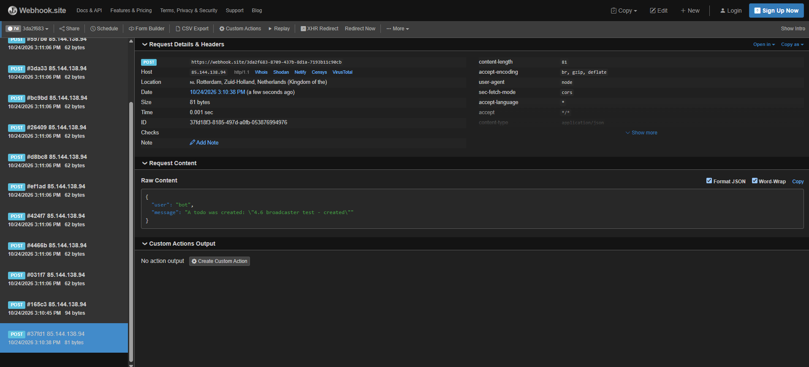
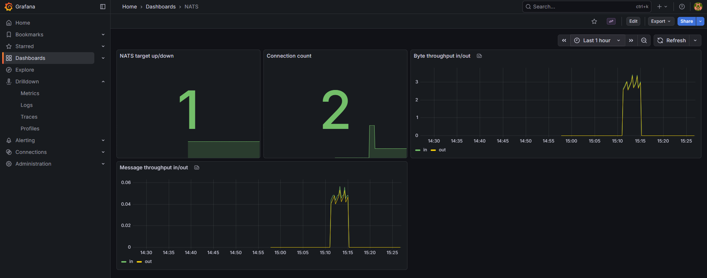

# broadcaster

Exercise 4.6: a separate service that broadcasts todo status changes to an external chat service. It doesn't talk to Postgres or serve any app functionality itself — its only jobs are subscribing to NATS and forwarding what it hears.

## How it fits together

- `../todo-backend` publishes a `todo_events` message to [NATS](https://nats.io/) (`my-nats.nats.svc.cluster.local:4222`, installed via Helm per the chapter 5 "Messaging systems" reading — see the root README) whenever a todo is created (`POST /todos`) or updated (`PUT /todos/<id>`, exercise 4.5's "Done" field).
- `broadcaster` subscribes to that same subject and, for every event it receives, sends a `POST` to an external "Generic" webhook (`WEBHOOK_URL`) with the payload shape the exercise specifies: `{"user": "bot", "message": "..."}`.

`todo-backend` publishing is best-effort: if NATS is unreachable, it logs a warning and the todo is still created/updated normally — core app functionality doesn't depend on the broadcast succeeding.

## Scaling without duplicate messages

The exercise's actual requirement ("can run with 6 replicas without issues... a duplicate is an issue, a randomly missing message is not") is solved entirely by NATS' own [queue group](https://docs.nats.io/nats-concepts/core-nats/queue) semantics, with no deduplication logic needed in the app itself: every `broadcaster` replica subscribes to `todo_events` under the same queue group name (`"broadcaster"`), so NATS hands each published message to exactly one member of the group — never more than one, and (per Core NATS' at-most-once delivery) not guaranteed to every member if one happens to be down, which is explicitly fine per the exercise.

**Tested**: scaled `broadcaster` to 6 replicas (`kubectl scale deployment/broadcaster -n project --replicas=6`), then created 10 todos in a row. Checked each pod's logs individually — the 10 events (ids 54–63) were split across 5 of the 6 pods (1/0/3/2/2/2), every id appearing in exactly one pod's log, confirmed via webhook.site that exactly 10 (not more, not fewer) messages arrived. Scaled back down to 1 replica afterwards (6 is only needed to demonstrate the requirement, not for normal operation at this traffic level).



A working broadcaster, end to end: `POST /todos` with text `"4.6 broadcaster test - created"` → `todo-backend` publishes a `created` event to NATS → `broadcaster` picks it up and `POST`s `{"user": "bot", "message": "A todo was created: \"4.6 broadcaster test - created\""}` to the webhook.site URL in `WEBHOOK_URL` — visible above as one of several requests received during testing.

The same scaling test, seen from the NATS side via the Grafana dashboard set up for the chapter 5 "Messaging systems" reading material (see root README):



"Connection count" steps from 2 (`todo-backend` + 1 `broadcaster`) up to 7 while scaled to 6 replicas, back down to 2 afterwards; "Message throughput in/out" and "Byte throughput in/out" both show a matching spike for the burst of 10 todos created during that window.

## Generic webhook

```bash
# manifests/webhook-secret.yaml holds WEBHOOK_URL (a webhook.site test endpoint for
# local verification — see the Secret's own comment for why this is committed)
kubectl apply -f manifests/webhook-secret.yaml
kubectl apply -f manifests/deployment.yaml
```

```bash
# trigger from the already-running app, or directly:
curl -s -X POST -H "Content-Type: application/json" -d '{"text":"hello"}' http://localhost:8081/todos
curl -s -X PUT -H "Content-Type: application/json" -d '{"done":true}' http://localhost:8081/todos/<id>

# watch it happen
kubectl logs -n project -l app=broadcaster -f
```
